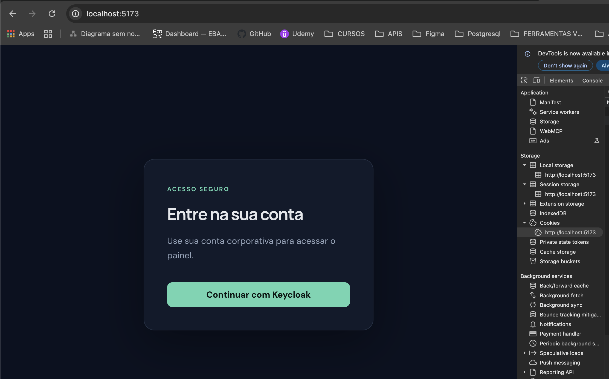
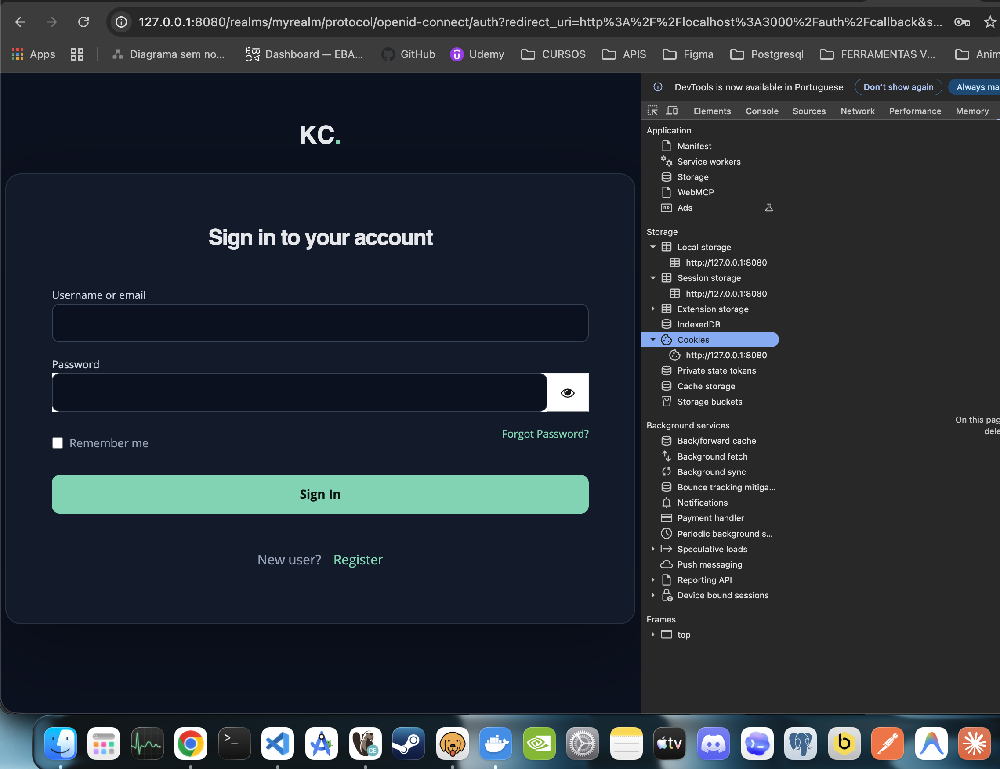
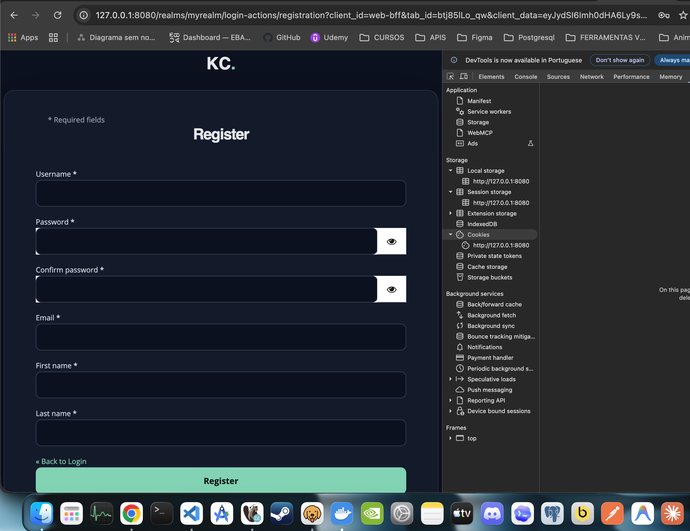
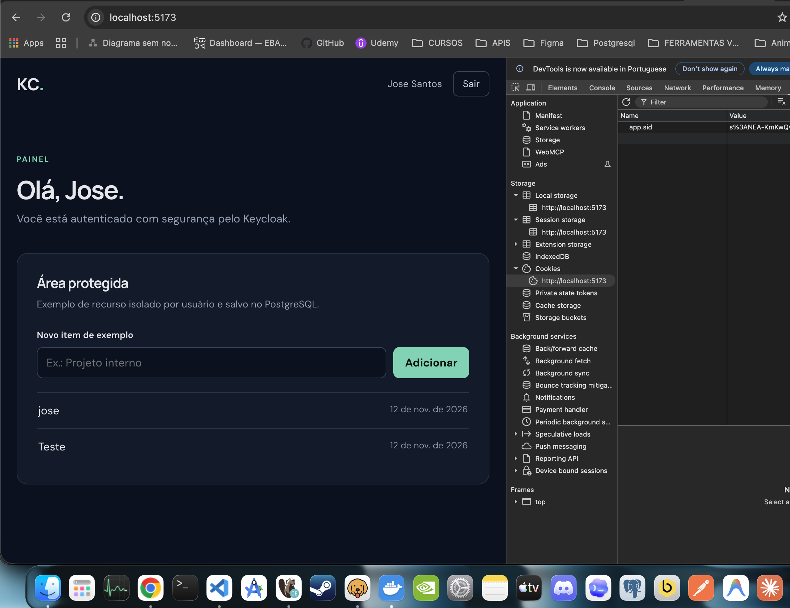

# Aplicação full-stack com Keycloak

Monorepo de exemplo com:

- `apps/api`: Node.js, TypeScript, Express, MVC + services, PostgreSQL, Prisma e sessão server-side.
- `apps/web`: React, TypeScript, Vite, arquitetura por feature, Zod, Zustand e TanStack Query.
- `docker-compose.yml`: PostgreSQL, API e frontend para desenvolvimento local.
- `Dockerfile` e `render.yaml`: mantêm o serviço Keycloak existente no Render.

O login usa Authorization Code + PKCE no backend (BFF). O navegador recebe apenas um cookie de sessão `HttpOnly`; os tokens OIDC não são enviados ao frontend. O exemplo inclui perfil protegido e CRUD de criação/listagem de itens por usuário. Em desenvolvimento, um issuer HTTP em `localhost`, `127.0.0.1` ou `::1` é permitido para Keycloak local; fora de loopback ou em produção, HTTPS é obrigatório.

## Pré-requisitos

- Node.js 22+
- Docker com Docker Compose
- Uma instância Keycloak acessível tanto pelo navegador quanto pela API
- Um Realm e um client confidencial configurado no Keycloak

## Configuração do Keycloak

No Realm desejado, crie um client OpenID Connect confidencial:

1. Habilite **Client authentication** e **Standard flow**.
2. Desabilite **Direct access grants**.
3. Configure **Valid redirect URIs** com `http://localhost:3000/auth/callback`.
4. Configure **Valid post logout redirect URIs** com `http://localhost:5173/*`.
5. Copie o client secret para `KEYCLOAK_CLIENT_SECRET`.

O client ID padrão esperado neste exemplo é `web-bff`. Não use esse secret de desenvolvimento em produção. O issuer tem o formato `https://seu-host/realms/seu-realm` e deve ser resolvível pelo browser e pela API.

## Tema visual do Keycloak

O tema `site` aplica as cores e o estilo do frontend às páginas nativas de login, cadastro, recuperação de senha e mensagens do Keycloak, mantendo os formulários e a lógica originais do provedor.

1. Recrie/republique a imagem Docker do Keycloak para incluir `themes/site`:

   ```sh
   docker build -t keycloak-site .
   ```

   No Render, faça um novo deploy do serviço Keycloak configurado para usar o Dockerfile da raiz.

2. No Admin Console, abra **Realm settings → Themes** e escolha `site` em **Login theme**. Salve a alteração.
3. Para oferecer cadastro e recuperação de senha, abra **Realm settings → Login** e habilite **User registration** e **Forgot password**.

Para desenvolvimento local, inicie o Keycloak usando a imagem criada acima (na porta desejada) ou monte `themes/site` em `/opt/keycloak/themes/site` no container local. Se o tema não aparecer imediatamente, reinicie o Keycloak e atualize a página sem cache.

## Rodar localmente

```sh
cp .env.example .env
```

Edite `.env` com o issuer e o secret do client Keycloak. Para usar o serviço Keycloak deste repositório, publique-o no Render, crie o Realm/client e use a URL HTTPS pública como issuer. `SESSION_SECRET` deve ser substituído por um valor aleatório forte.

Suba o PostgreSQL, a API e o frontend:

```sh
docker compose up --build
```

Ou rode a aplicação diretamente no host:

```sh
npm install
npm run db:migrate --workspace=@keycloak-app/api
npm run dev
```

Frontend: <http://localhost:5173>. API: <http://localhost:3000/health>. O login encaminha para `/auth/login`, e o callback OIDC retorna ao backend.

## Estrutura

```text
apps/
  api/
    prisma/                 # schema e migrations
    src/
      config/               # ambiente e Prisma
      features/
        auth/               # login, callback, sessão e logout
        examples/            # recurso de exemplo
      middleware/           # autenticação e CSRF
      shared/               # erros, validação e handlers
  web/
    src/
      app/                  # composição da aplicação
      features/
        auth/                # service, queries, mutations, hooks e store
        dashboard/           # views
        examples/            # service, schema/types, queries, mutations, hooks e components
      shared/                # cliente HTTP e CSRF
```

## Validação

```sh
npm run typecheck
npm run build
```

## Deploy e segurança

O `render.yaml` atual segue publicando somente o Keycloak pelo Dockerfile da raiz. A API e o frontend têm Dockerfiles próprios em `apps/api` e `apps/web`; para implantá-los, crie serviços Render separados apontando para esses Dockerfiles, configure as variáveis do `.env.example` e use PostgreSQL gerenciado com armazenamento persistente.

Em produção, defina `COOKIE_SECURE=true`, use HTTPS, mantenha API e frontend em origens compatíveis com cookie `SameSite=Lax`, restrinja as URLs de redirect do client e configure o `WEB_ORIGIN` exato. Defina `VITE_API_URL` como argumento de build do frontend. Não publique o PostgreSQL nem use credenciais padrão em produção. Antes de iniciar uma nova versão da API, aplique as migrations com `npm run db:migrate:deploy --workspace=@keycloak-app/api` apontando `DATABASE_URL` ao banco de produção. A sessão de autenticação fica no PostgreSQL.





